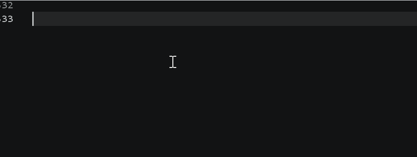

# ⌨️ TypingSimulator (AutoHotkey v2)

A configurable typing simulator that reproduces *human-like* typing into any
focused editor (built for VS Code): variable per-character delays, occasional
typos with real backspace corrections, word/thinking pauses, and code-block
aware hesitation — controlled entirely by hotkeys.

## ✨ Features
- **Realistic timing engine** — separate delay ranges for letters, digits,
  symbols, punctuation, spaces, line ends and blank lines.(which u can edit btw depending on your likes)
- **Mistake & correction model** — random wrong keys, multi-character
  backspace repairs, retyping of the correct segment.
- **Natural pauses** — word pauses, "thinking" pauses, and heuristic pauses
  around braces/blocks so output doesn't look robotic.
- **Target focus detection** — waits (with tray-tip status) until VS Code is
  the active window before typing.
- **Full hotkey control** — F6 start, F7 pause/resume, F8 stop, F9 reload
  source file, Esc emergency stop (active only while running).
- **One-file config** — every knob lives in the `SimConfig` class at the top.

## 🎬 Demo
   <!-- record one with ScreenToGif — this matters most -->

## 🚀 Quick start
1. Install AutoHotkey v2.
2. Put your source text in `text.txt` next to the script (or change
   `InputFile` in `SimConfig`).
3. Run `TypingSimulator.ahk`, focus VS Code, press **F6**.

## ⚙️ Configuration
| Setting | Default | Meaning |
|---|---|---|
| `TypingSpeed` | 1.0 | Global speed multiplier |
| `MistakeChance` | 0.018 | Per-character typo probability |
| `HotkeyStart` | F6 | Start simulation |
| ... | | |

## ⚖️ Intended use
Built for demos, UI testing, accessibility research and automation
experimentation. Do not use it to misrepresent automated work or to defeat
activity/attendance monitoring.

## 📄 License
MIT
